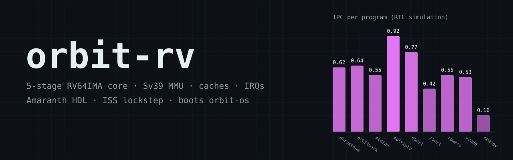
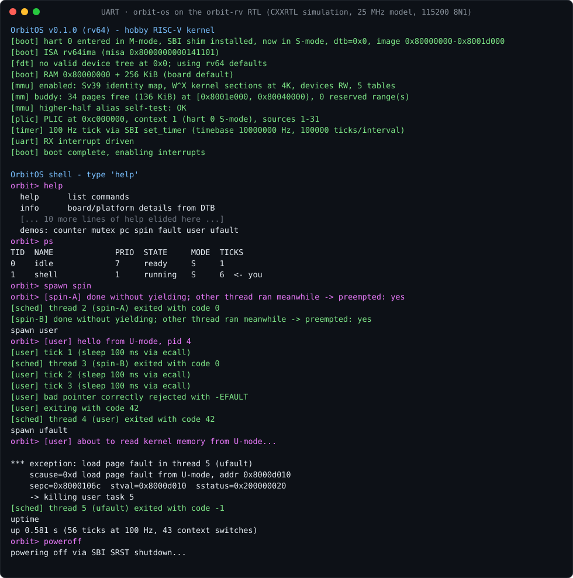
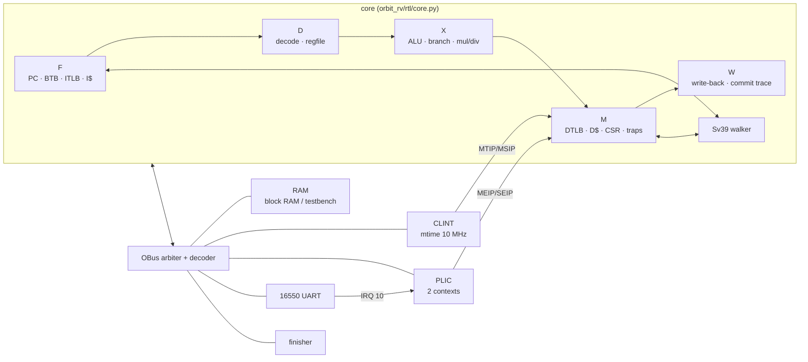

<p align="center">
  
</p>

<p align="center">
  <a href="https://github.com/coopersimpson101-debug/orbit-rv/actions/workflows/ci.yml"></a>
  <a href="https://github.com/coopersimpson101-debug/orbit-rv/releases/latest"></a>
  <a href="LICENSE"></a>
  
  
  
</p>

**A 64-bit RISC-V CPU you can read in an afternoon and that boots a real kernel:** a 5-stage
pipelined RV64IMA core with caches, an Sv39 MMU and interrupts, written in Amaranth HDL, checked
instruction by instruction against a hand-written golden ISS (and Spike in CI), synthesised for an
ECP5 FPGA, and running [orbit-os](https://github.com/coopersimpson101-debug/orbit-os) to its shell.

<p align="center">
  <a href="#quickstart">Quickstart</a> ·
  <a href="#how-it-works">How it works</a> ·
  <a href="#results">Results</a> ·
  <a href="#hardware-validation--todo-for-the-author">Hardware TODO</a> ·
  <a href="docs/microarchitecture.md">Microarchitecture</a> ·
  <a href="docs/verification.md">Verification</a>
</p>

<p align="center">
  
</p>
<p align="center"><sub>Real UART output, decoded bit by bit from the TX pin of the SoC's 16550 model, while
orbit-os boots on the <b>RTL in simulation</b> (CXXRTL, 25 MHz clock model, 256 KiB RAM as on the FPGA) and a
script types into the RX pin. All 5,978,340 committed instructions and traps of this run were checked
against the golden ISS. Full log: <a href="docs/results/orbit-os-uart.txt">docs/results/orbit-os-uart.txt</a>.
Regenerate: <code>python tools/boot_os.py --kernel ../orbit-os/build/rv64/kernel.elf</code>. Not hardware.</sub></p>

**IPC, measured in RTL simulation** (whole program incl. startup; every run lockstep-checked against the ISS;
Windows/Ryzen 5 3600 host, 2026-11-26):

| program | instructions | cycles | **IPC** | I$ hit | D$ hit | branch/jump prediction |
|---|---:|---:|---:|---:|---:|---:|
| dhrystone | 294,403 | 473,590 | **0.62** | 100.0% | 94.0% | 78.5% |
| orbitmark | 233,828 | 366,060 | **0.64** | 100.0% | 99.3% | 83.2% |
| median | 13,229 | 24,081 | **0.55** | 99.6% | 87.7% | 76.0% |
| multiply | 58,390 | 63,245 | **0.92** | 99.9% | 94.2% | 96.1% |
| qsort | 269,271 | 350,147 | **0.77** | 100.0% | 95.1% | 81.8% |
| rsort | 365,664 | 877,486 | **0.42** | 100.0% | 81.0% | 99.0% |
| towers | 11,182 | 20,372 | **0.55** | 99.3% | 94.8% | 78.7% |
| vvadd | 9,087 | 17,180 | **0.53** | 99.4% | 84.0% | 94.0% |
| memcpy | 218,941 | 1,350,164 | **0.16** | 100.0% | 5.9% | 99.7% |
| irqtest | 3,936 | 32,508 | **0.12** | 98.5% | 97.0% | 92.6% |
| orbit-os boot + session | 5,978,098 | 16,243,226 | **0.37** | 99.9% | 99.6% | 99.1% |

<sub>`orbitmark` is a CoreMark-style workload written for this repo, not CoreMark. `memcpy`'s source and
destination arrays map to the same sets of the direct-mapped 4 KiB D-cache, so it thrashes - a real
weakness of direct mapping that the table shows rather than hides. Prediction accuracy counts all
branches and jumps resolved in execute.</sub>

## Highlights

- **5-stage in-order RV64IMA_Zicsr_Zifencei pipeline** with full forwarding, a one-bubble load-use
  interlock, a 32-entry BTB with 2-bit counters, precise traps at the commit point, M/S/U modes and
  delegation, CLINT timer/software and PLIC external interrupts, WFI.
- **Sv39 MMU**: 4-entry ITLB and 8-entry DTLB with superpages, and a hardware page-table walker that
  reads PTEs *through the D-cache*; **4 KiB I-cache and write-back D-cache** (VIPT, 32-byte lines), FENCE.I.
- **191/194 official riscv-tests pass on the RTL** (rv64ui/um/ua `-p` and `-v`, rv64mi/si `-p`),
  every commit checked against the ISS; the 3 failures are by design (misaligned accesses trap, no PMP).
- **orbit-os boots on the RTL**: M-mode SBI shim, S-mode kernel with Sv39 and W^X, timer preemption,
  U-mode tasks and fault isolation - 5,978,098 instructions in 16,243,226 simulated cycles, all lockstep-checked.
- **Lockstep found a real bug** riscv-tests missed (a store could commit while the D-cache was still
  refilling for an interrupted load) - see [verification](docs/verification.md).
- **Runs on pip alone**: Amaranth -> Yosys CXXRTL -> `zig c++` gives a cycle-accurate model of the whole SoC (48 k cycles/s on the orbit-os run while also writing the full commit log);
  the riscv-tests are built with `zig cc`; YoWASP Yosys + nextpnr place and route it for the ULX3S 85F
  (17,885 LUT4s, 6,501 FFs, 134 DP16KD).

## Status

| | what | how it was checked |
|---|---|---|
| ✅ | RTL unit tests (M unit, decoder, UART, PLIC, TLB) + ISS unit tests | `pytest`, locally and in CI |
| 🧪 | riscv-tests on the RTL: **191/194**, each commit lockstep-checked against the ISS | CXXRTL simulation, locally; CI |
| 🧪 | orbit-os boot + shell session on the RTL (256 KiB, 25 MHz model), lockstep-checked | CXXRTL simulation, locally |
| 🧪 | IPC / cache hit rate / prediction accuracy for 10 programs | CXXRTL simulation, locally; CI |
| 🧪 | Spike commit-log comparison (ISS vs Spike, RTL vs Spike) | CI only (Spike built from source) - see the CI job summary for the result |
| ✅ | ECP5 synthesis, place-and-route and bitstream for the ULX3S 85F: post-route Fmax **27.36 MHz**, meets the 25 MHz target | yowasp-yosys / yowasp-nextpnr-ecp5 / ecppack, locally; CI |
| ⏳ | **Board boot on a ULX3S** (UART log) | [TODO for the author](#hardware-validation--todo-for-the-author) |
| 🗺️ | C extension, PMP, 2-way caches, store buffer | [roadmap](#roadmap) |

## Quickstart

```sh
pip install -e ".[dev]"            # Amaranth, YoWASP Yosys, zig (cc/c++), pytest
git clone https://github.com/riscv-software-src/riscv-tests build/riscv-tests-src && git -C build/riscv-tests-src checkout 1b3f8bd665d79e5985753a558dae4e3718e2edc8 && git -C build/riscv-tests-src submodule update --init env
python tools/build_riscv_tests.py --src build/riscv-tests-src --out build/riscv-tests
python tools/run_riscv_tests.py --dir build/riscv-tests --sim rtl --lockstep   # builds the simulator once (~5 min)
python -m pytest -q tests
```

More: `python tools/build_benchmarks.py --src build/riscv-tests-src --out build/bench` then
`python tools/perf_table.py --bench build/bench`; `python tools/boot_os.py --kernel <orbit-os>/build/rv64/kernel.elf`;
`python fpga/ulx3s.py --image <orbit-os>/build/rv64/kernel.bin` ([FPGA guide](docs/fpga.md));
`python -m orbit_rv.iss prog.elf --log commits.log` (golden ISS); `python tools/export_verilog.py` (Verilog netlist).

## How it works



| part | where | summary |
|---|---|---|
| Pipeline, CSRs, traps | [`rtl/core.py`](orbit_rv/rtl/core.py) | 5 stages, forwarding from M and W, load-use bubble, BTB, precise traps in M |
| Decoder | [`rtl/decode.py`](orbit_rv/rtl/decode.py) | RV64IMA + Zicsr + Zifencei + privileged ops, illegal detection |
| Caches | [`rtl/cache.py`](orbit_rv/rtl/cache.py) | VIPT direct-mapped 4 KiB, 32-byte lines, D$ write-back + FENCE.I flush |
| MMU | [`rtl/mmu.py`](orbit_rv/rtl/mmu.py) | fully-associative TLBs, Sv39 walker through the D$, Svade |
| M unit | [`rtl/muldiv.py`](orbit_rv/rtl/muldiv.py) | 4-cycle multiplier, 64-cycle restoring divider |
| SoC | [`rtl/soc.py`](orbit_rv/rtl/soc.py), [`rtl/periph.py`](orbit_rv/rtl/periph.py), [`rtl/bus.py`](orbit_rv/rtl/bus.py) | OBus, CLINT, PLIC, UART, finisher, block RAM - [memory map](docs/memory-map.md) |
| Golden ISS | [`iss/hart.py`](orbit_rv/iss/hart.py) | instruction-accurate RV64IMA, CSRs, traps, Sv39, devices |
| Simulation | [`sim/`](orbit_rv/sim) | CXXRTL build, C++ testbench (RAM, UART line codec), lockstep checker |

**Why Amaranth.** There is no Verilator, Icarus or JVM on the development machine, so the RTL is
written in Amaranth HDL, a Python-embedded HDL in the same spirit as Chisel. It installs from PyPI,
its built-in simulator runs the block tests, and Yosys turns its RTLIL into a fast C++ model
(CXXRTL), a plain Verilog netlist for SystemVerilog flows, and the ECP5 netlist. Details in
[docs/microarchitecture.md](docs/microarchitecture.md).

<details>
<summary><b>The algorithms, briefly</b></summary>

**Performance (iron law).** Run time T = N<sub>insn</sub> x CPI x t<sub>clk</sub>, and IPC = 1/CPI.
For an in-order scalar pipeline, CPI = 1 + (bubbles per instruction): load-use bubbles
(1 each), taken mispredictions (2: F and D flushed), cache refills (4 bus beats x 2 cycles plus
a write-back of about 8 cycles for a dirty victim), page walks (a few cycles per level when the PTE hits in
the D$), multiply (4) and divide (64), and serialising instructions (CSR writes, xRET: a pipeline refill of about 3 cycles).

**Branch prediction.** Each BTB entry holds a 2-bit saturating counter c in {0,1,2,3};
predict taken iff c >= 2; on resolution c <- min(c+1, 3) if taken else max(c-1, 0)
(Smith, 1981). Two consecutive mispredictions are needed to flip a strongly biased branch,
which is why loop-closing branches cost one misprediction per loop exit.

**VIPT cache constraint.** With page size P = 4 KiB, a cache can be indexed with the untranslated
address only if (sets x line size) <= P, i.e. 128 sets x 32 B per way - here a 4 KiB direct-mapped
cache - so the RAM read starts in the address-generation stage while the TLB translates in parallel.

**Sv39 translation.** VA[38:0] = VPN2 | VPN1 | VPN0 | offset (9+9+9+12 bits), VA[63:39] must equal
VA[38]. Starting at a = satp.PPN x 4096, for level i = 2, 1, 0 read PTE = mem[a + VPN<sub>i</sub> x 8];
if R or X is set it is a leaf: PA = PPN[43:9i] | VA[12+9i-1:0] (superpage; the lower PPN bits must be
zero), else a = PTE.PPN x 4096 and continue (RISC-V Privileged Spec, sec. 4.3.2).

**Restoring division.** For k = 63..0: R <- 2R + bit<sub>k</sub>(dividend); if R >= divisor
then R <- R - divisor and q<sub>k</sub> = 1. Signs are applied to magnitudes at the end; x/0 and
the signed-overflow case are answered directly as the ISA defines (all ones / dividend; MIN / 0).
</details>

**References.** *The RISC-V Instruction Set Manual*, Vol. I Unprivileged ISA (20191213) and Vol. II
Privileged Architecture (20211203); D. A. Patterson, J. L. Hennessy, *Computer Organization and
Design RISC-V Edition* (pipelining, hazards, caches); J. E. Smith, "A Study of Branch Prediction
Strategies", ISCA 1981; [riscv-tests](https://github.com/riscv-software-src/riscv-tests);
[Spike](https://github.com/riscv-software-src/riscv-isa-sim);
[Amaranth HDL](https://amaranth-lang.org/); Yosys [CXXRTL](https://yosyshq.readthedocs.io/projects/yosys/en/latest/cmd/write_cxxrtl.html);
[nextpnr](https://github.com/YosysHQ/nextpnr) / [Project Trellis](https://github.com/YosysHQ/prjtrellis).

## Results

All numbers below were produced on this machine on 2026-11-26 by the tools named; raw files are in
[`docs/results/`](docs/results).

**riscv-tests** (commit `1b3f8bd`, built with `zig cc` for rv64ima, run with
`tools/run_riscv_tests.py`; on the RTL every commit is also checked against the ISS):

| suite | golden ISS | RTL (lockstep) | failing (both) |
|---|---:|---:|---|
| rv64ui-p | 53/54 | 53/54 | ma_data |
| rv64ui-v | 51/52 | 51/52 | ma_data |
| rv64um-p | 13/13 | 13/13 | - |
| rv64um-v | 13/13 | 13/13 | - |
| rv64ua-p | 19/19 | 19/19 | - |
| rv64ua-v | 19/19 | 19/19 | - |
| rv64mi-p | 16/17 | 16/17 | pmpaddr |
| rv64si-p | 7/7 | 7/7 | - |
| **total** | **191/194** | **191/194** | |

`ma_data` expects hardware support for misaligned accesses (orbit-rv traps them, which the spec
allows); `pmpaddr` needs PMP entries (orbit-rv has none). `rv64mi-p-breakpoint` passes through its
"no triggers implemented" path.

**orbit-os on the RTL** ([`orbit-os-boot.json`](docs/results/orbit-os-boot.json)): 5,978,098 instructions,
16,243,226 cycles (0.65 s of simulated time at 25 MHz; IPC 0.37, low because the kernel idles in WFI
and polls the UART at 115200 baud), 242 traps and interrupts, 1,193 page-table walks; the
lockstep check matched all 5,978,340 commits and traps. Simulator speed: 338 s wall clock for the run.

**FPGA** (ULX3S, LFE5U-85F-6BG381C; `python fpga/ulx3s.py --image kernel.bin`; yowasp-yosys 0.71,
yowasp-nextpnr-ecp5 0.11, seed 1; [`fpga.json`](docs/results/fpga.json)):

| resource | used | available | |
|---|---:|---:|---:|
| LUT4 + carry (TRELLIS_COMB) | 17,885 | 83,640 | 21% |
| flip-flops | 6,501 | 83,640 | 8% |
| block RAM (DP16KD, 18 Kbit) | 134 | 208 | 64% |
| DSP multipliers (MULT18X18D) | 4 | 156 | |
| distributed RAM (register file) | 64 TRELLIS_RAMW | 10,455 | |
| **post-route Fmax** | **27.36 MHz** | target 25 MHz | meets 25 MHz |

Most of the block RAM is the 256 KiB main memory (128 DP16KD); the caches use 6. The critical path
starts at the M-stage virtual address and runs through the DTLB CAM and the physical-address range
checks. Two RTL changes were made for timing, both re-verified with the full riscv-tests lockstep
run and the orbit-os boot. Measured post-route Fmax (one seed each): 24.09 MHz for the first
version; 23.42 MHz after the D-cache read-address select was switched to last cycle's stall (no
gain within seed noise); 27.36 MHz after AMOs were given an extra cycle so that block-RAM read data
no longer feeds block-RAM write data through the AMO ALU in one cycle.

## Hardware validation / TODO for the author

Everything above is simulation or tool reports. On a ULX3S 85F (see [docs/fpga.md](docs/fpga.md)):

```sh
python build.py --board rv64                                   # in orbit-os (branch feat/riscv64-port)
python fpga/ulx3s.py --image ../orbit-os/build/rv64/kernel.bin  # in orbit-rv -> build/fpga/orbit_rv.bit
openFPGALoader --board ulx3s build/fpga/orbit_rv.bit
python -m serial.tools.miniterm /dev/ttyUSB0 115200 --raw | tee docs/results/board-uart.txt
```

| check | expected | result |
|---|---|---|
| boot banner and `orbit>` prompt over the FTDI UART | same lines as the simulated log | ⏳ |
| `spawn spin` / `spawn user` / `spawn ufault` | preemption, U-mode syscalls, fault kills only the task | ⏳ |
| `uptime` vs a stopwatch after 60 s | within 1 % (mtime = 10 MHz from 25 MHz) | ⏳ |
| `poweroff` | LED0 on | ⏳ |
| timing margin | nextpnr says 27.36 MHz for 25 MHz; check stability over a long `spawn spin` run | ⏳ |

## Roadmap

- More timing margin (register the DTLB hit/PA) and a PLL for a faster clock.
- C extension (compressed fetch with a 16-bit-aligned fetch buffer).
- PMP (16 entries), so `pmpaddr` passes and QEMU/OpenSBI firmware can run unmodified.
- 2-way set-associative D$ (fixes the `memcpy` conflict misses) and a store buffer.
- Return-address stack for JALR returns; gshare in place of per-entry counters.
- SDRAM controller for the ULX3S's 32 MB, so orbit-os can use more than 256 KiB.

## License

MIT - see [LICENSE](LICENSE). riscv-tests, Spike, Amaranth, Yosys and nextpnr are fetched from their
official repositories/PyPI at build time and keep their own licenses.

<sub>Downloaded to build/run here: PyPI packages `amaranth` 0.5.10, `yowasp-yosys` 0.71, `yowasp-nextpnr-ecp5`,
`ziglang` 0.17.1, `pyelftools`, npm `@resvg/resvg-js` (banner PNG); the
riscv-tests repository from github.com/riscv-software-src at commit `1b3f8bd`.</sub>
