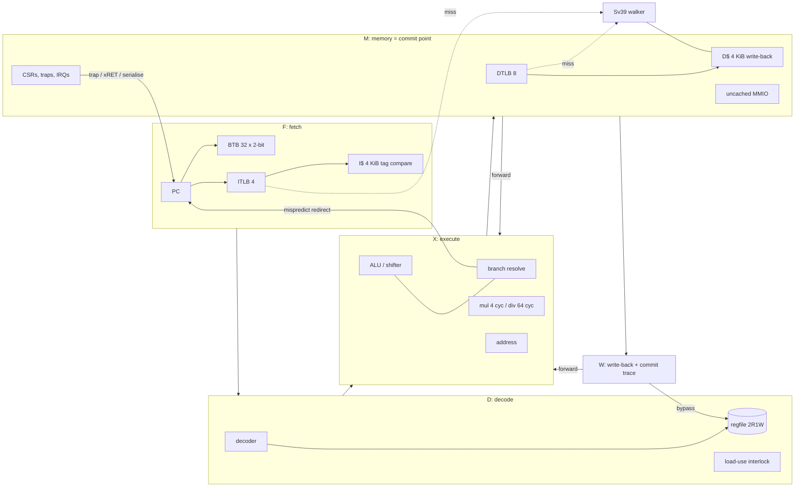

# Microarchitecture

orbit-rv is a single-issue, in-order, 5-stage RV64 pipeline. Source:
[`orbit_rv/rtl/core.py`](../orbit_rv/rtl/core.py) (pipeline, CSRs, traps),
[`cache.py`](../orbit_rv/rtl/cache.py), [`mmu.py`](../orbit_rv/rtl/mmu.py),
[`muldiv.py`](../orbit_rv/rtl/muldiv.py), [`decode.py`](../orbit_rv/rtl/decode.py),
[`periph.py`](../orbit_rv/rtl/periph.py), [`soc.py`](../orbit_rv/rtl/soc.py).

## Pipeline

| stage | work | stalls / flushes |
|---|---|---|
| **F** | PC, BTB lookup (32 entries, direct mapped, 13-bit partial tag, 39-bit target, 2-bit counter), ITLB translate, I-cache tag compare (the block-RAM read was issued a cycle earlier with the next PC) | holds on I$ miss, ITLB walk, or D stall |
| **D** | decode, register-file read with a W-stage bypass, load-use detection | inserts one bubble when X holds a load/AMO/CSR read whose rd is a source |
| **X** | ALU, branch compare + target, misaligned-target check, mul/div, effective address; D$ index presented to block RAM (s0) | redirects F/D on a misprediction; holds while the M unit is busy |
| **M** | DTLB, D-cache tag compare and data return, AMO/LR/SC, uncached MMIO, CSR read/write, exceptions and interrupts | holds on D$ miss, walker, MMIO, WFI, FENCE.I flush |
| **W** | register write, commit trace port | - |

**Forwarding.** X takes operands from M (non-late results) and W. While X is
held, the forwarded values are written back into its operand registers, so a
producer that leaves W during the stall is not lost. Late results (loads,
AMOs, SC, CSR reads) are only available at the end of M and cost one
load-use bubble.

**Branch prediction.** F predicts with the BTB: a hit with counter >= 2 is
predicted taken to the stored target. X resolves every branch/jump and
compares the real next PC with the predicted one; on a mismatch it flushes F
and D and redirects (2-cycle penalty). JAL/JALR entries are installed
strongly taken; a BTB hit on a non-control instruction (partial-tag alias)
invalidates the entry.

**Commit point and precise traps.** An instruction that leaves M cannot trap
any more. Exceptions found anywhere (fetch faults, illegal instructions,
misaligned targets, ECALL/EBREAK, misaligned/page/access faults on data,
CSR privilege violations) travel with the instruction and are taken in M,
in priority order. Interrupts are taken in M on a valid instruction that has
not started a side effect (an MMIO access); it is squashed and becomes the
EPC. Instructions that change state that younger instructions depend on
(CSR writes, MRET/SRET, WFI, SFENCE.VMA, FENCE.I) flush the pipeline and
redirect to the next PC when they commit.

## Memory system

**Caches.** I$ and D$ are 4 KiB, direct mapped, 32-byte lines, block-RAM data
and tag arrays, valid/dirty bits in flip-flops (one-cycle invalidate). They
are virtually indexed and physically tagged: the index comes from bits
[11:3], inside the page offset, so the RAM read starts in the stage before
the TLB translation is known. Every cycle the cache reads either the next
request (when the pipeline advances) or the current one again; a request only
hits if the RAM output really belongs to it (``r_ok``), which makes stalls,
refill replays and walker ownership changes safe without special cases. The
D$ is write-back/write-allocate; a dirty victim is written back before the
refill. FENCE.I writes back every dirty line and then invalidates the I$. The
D$ reports a hit only while its refill FSM is idle (a request killed by an
interrupt may still be refilling a different line).

**MMU.** Sv39 with a 4-entry ITLB and an 8-entry DTLB, fully associative,
round-robin replacement, superpages (1 GiB / 2 MiB / 4 KiB). Permission
checks (U, SUM, MXR, R/W/X, D on stores) happen at lookup time against the
current effective privilege (MPRV respected for data), so no flush is needed
on mode switches. The hardware walker reads PTEs **through the D-cache**,
so page tables that the kernel has just written (dirty in the cache) are
seen. It checks V, R/W encoding, reserved bits [63:54], non-leaf A/D/U,
misaligned superpages and PPN range. ASIDLEN is 0; SFENCE.VMA and satp writes
flush both TLBs.

**Interconnect.** OBus: a simple request/acknowledge bus (64-bit data, byte
enables), 2-master fixed-priority arbiter (data side first), address decoder.
Block RAM answers in one cycle, so a line refill is 4 x 2 cycles.

## Privileged architecture

M, S and U modes; `mstatus` (SIE MIE SPIE MPIE SPP MPP FS MPRV SUM MXR TVM TW
TSR, SD, UXL=SXL=64), `medeleg`/`mideleg`, `mie`/`mip`, `mtvec`/`stvec`
(direct and vectored), `mepc`/`sepc`, `mcause`/`scause`, `mtval`/`stval`,
scratch registers, `mcounteren`/`scounteren`, `satp`, `mcycle`/`minstret`
and the user `cycle`/`time`/`instret` views. Interrupt priority MEI > MSI >
MTI > SEI > SSI > STI. MRET/SRET follow the spec (MPP/SPP cleared, MPRV
cleared when leaving M).

Implementation choices allowed by the specification, shared by the RTL and
the golden ISS (and documented so the kernel port can rely on them):

| choice | consequence |
|---|---|
| Svade: hardware never sets PTE.A/D | A=0, or D=0 on a store, is a page fault; software pre-sets A/D |
| `mstatus.FS` writable without an FPU (as in Spike), SD = (FS == Dirty); XS, VS read 0 | S-mode software may track/emulate FP state; matches Spike's `sstatus` |
| misaligned loads/stores/AMOs trap | `rv64ui-*-ma_data` fails (it expects hardware support) |
| no PMP entries (`pmpcfg*`/`pmpaddr*` read 0) | `rv64mi-p-pmpaddr` fails |
| no debug triggers (`tselect`/`tdata*` read 0) | `rv64mi-p-breakpoint` passes via its "no triggers" path |
| WFI stalls until `mip & mie != 0` | U-mode WFI and S-mode WFI with TW=1 are illegal |
| physical addresses are 32 bits | PPNs above 4 GiB raise access faults |
| ASIDLEN = 0, no `mhpmcounter3+` events | those CSRs read zero |

## Multiply/divide

`MUL*`: four cycles of 64x16 partial products on operand magnitudes with a
final sign fix-up (MULHSU handled by per-operand signedness). `DIV*`/`REM*`:
restoring radix-2, 64 cycles, with divide-by-zero and signed overflow
answered in one cycle as the spec defines. W variants use sign- or
zero-extended 32-bit operands and sign-extend the result.

## Peripherals

See [memory-map.md](memory-map.md). CLINT (`mtime` at 10 MHz from any clock
via a fractional accumulator), PLIC (31 level-triggered sources, 3-bit
priorities, contexts M and S, claim/complete with in-service gating), a
16550 subset (16-byte FIFOs, 16x oversampled RX, DLAB divisor, IER/IIR/LSR),
and a QEMU-style finisher.

## Why Amaranth

The brief allowed SystemVerilog or Chisel. There is no Verilator, Icarus or
JVM on the development machine, so the RTL is written in
[Amaranth HDL](https://amaranth-lang.org/) (a Python-embedded HDL, the same
idea as Chisel): it installs with pip, its own simulator runs the block-level
tests, and it lowers to RTLIL, from which Yosys produces (a) a CXXRTL C++
model compiled with `zig c++` for fast full-system simulation, (b) plain
Verilog-2005 (`tools/export_verilog.py`), usable from SystemVerilog flows,
and (c) the ECP5 netlist.
