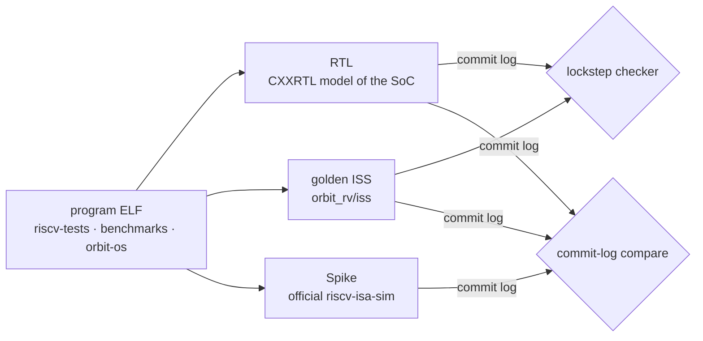

# Verification

Three independent models of the same ISA are compared instruction by instruction:

## 1. RTL vs golden ISS (runs here and in CI)

The core's W stage drives a commit-trace port (PC, encoding, privilege, rd and
value, store address/data, trap cause/EPC/TVAL, interrupt marker). The CXXRTL
testbench writes it as a Spike-style commit log; `orbit_rv/sim/lockstep.py`
replays it on the ISS:

* every committed instruction: same PC, encoding, privilege, destination
  register and value, store address and data;
* every exception: same cause, EPC and TVAL (the ISS must raise it too);
* interrupts: the RTL decides *when* (that is timing, not ISA); the ISS takes
  the same interrupt at the same instruction boundary and must agree on
  everything that follows;
* values the ISS cannot know - MMIO loads and reads of `cycle`, `time`,
  `mcycle`, `mip`/`sip` - are tagged `nd` by the RTL and copied into the ISS
  after the instruction itself has been checked.

This caught a real bug during development: a D-cache hit could be reported
while the refill FSM was still busy with a line for a load that had just been
squashed by an interrupt, so a store "committed" without writing the cache.
riscv-tests passed with the bug; the orbit-os boot did not survive lockstep.

## 2. riscv-tests (official suite, pinned commit)

`tools/build_riscv_tests.py` builds rv64ui/um/ua (-p and -v) and rv64mi/si
(-p) with `zig cc`. Two mechanical build adaptations, both documented in the
script: a redundant `.weak` directive is dropped when a test re-declares the
symbol `.global` (LLVM rejects the rebinding, GNU as accepts it), and
freestanding `string.h`/`stdio.h`/`ctype.h` shims are supplied for `env/v`.
A test passes when it writes `tohost = 1`; on the RTL every run is also in
lockstep with the ISS.

## 3. Spike (CI only)

`.github/workflows/ci.yml` job `spike` builds Spike from the official
`riscv-isa-sim` source at a pinned master commit (`982f078`, 2026-11-21; the
last release tag, v1.1.0, no longer compiles with current GCC), caches it,
runs every riscv-test and benchmark with
`--isa=rv64ima_zicsr_zifencei_zicntr_zihpm --log-commits`, and compares Spike against the ISS and the
RTL with `tools/spike_compare.py`: PC, encoding, privilege and integer
register writes from the ELF entry on. CSR reads whose values are
implementation-defined (misa, `m*id`, cycle/time, PMP, triggers, mip) and RTL
`nd` values are not value-compared. One architecturally allowed difference is
resynchronised rather than reported: an SC that fails spuriously on one side
(Spike drops reservations at its hart-interleave boundary every few thousand
instructions, which `rv64ua-p-lrsc`'s 1024-iteration loop hits) is skipped up
to that side's successful retry of the same SC. The tests orbit-rv fails by
design (`ma_data` -p/-v, `pmpaddr`) are not run on Spike, and a Spike run that
exceeds 300 s is recorded as a timeout instead of stopping the job. The job
fails if any other program differs or times out, except
`rv64mi-p-breakpoint` (Spike implements debug triggers, orbit-rv does not) and
`irqtest` (interrupt timing is not architectural). Benchmarks
are compared ISS-vs-Spike only: they compute with `mcycle`, so RTL values
legitimately diverge from Spike's after the first counter read (the RTL is
covered by the ISS lockstep instead). The result table is published in the
job summary.

The first CI run against Spike found one real divergence: Spike implements
`mstatus.FS` as writable without an FPU, so the riscv-tests `-v` environment
(which sets FS) reads back FS = Dirty and SD = 1 in `sstatus`, where orbit-rv
had FS hard-wired to 0. The privileged spec allows either when S-mode is
present (FS is only required to be read-only zero with neither F nor S-mode);
orbit-rv now implements FS as writable in both the ISS and the RTL, matching
Spike, and the riscv-tests lockstep and the orbit-os boot were re-run.

Spike could not be run on the Windows development machine: the
script's plumbing was exercised locally only with the ISS standing in for
Spike, so the real outcome is whatever CI reports.

## 4. Block-level tests (Amaranth simulator)

`tests/test_rtl_units.py`: the multiplier/divider against the ISS's
arithmetic on corner cases and random operands, the decoder's illegal
instruction detection against the ISS for random encodings of every opcode,
UART TX->RX loopback and registers, PLIC claim/complete, TLB superpage
translation and permission faults.
